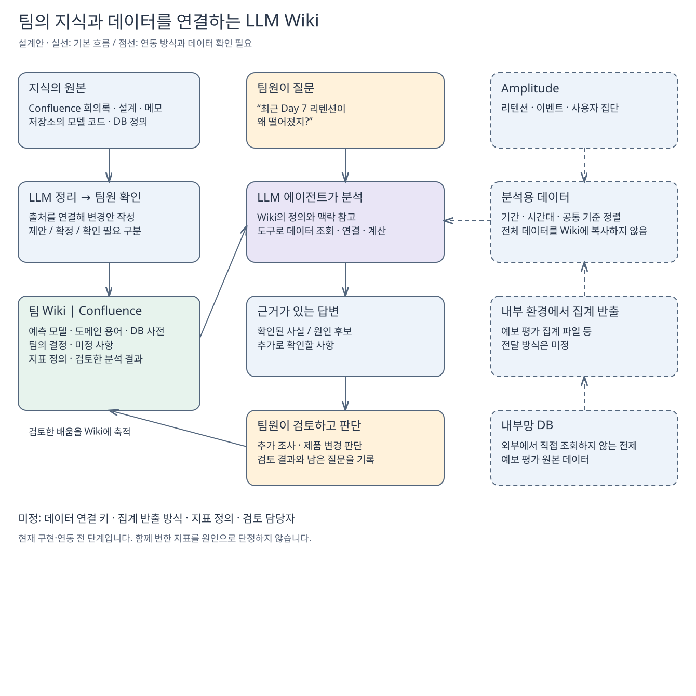

# salmonbus-llm-wiki

팀의 지식과 제품 데이터를 연결하는 LLM Wiki 설계 기록입니다.

**현재 상태: 파일 기반 분석 첫 버전.** Amplitude CSV와 선택적인 예보 평가 집계를 검증하고 Markdown 보고서를 생성합니다. 자동 수집과 Wiki 갱신은 구현하지 않았습니다.

## 실행

Python 3 표준 라이브러리만 필요합니다. 합성 자료로 실행합니다.

```sh
mkdir -p artifacts
python3 analysis.py --retention fixtures/retention.csv --contract fixtures/contract.json --start 2026-01-01 --end 2026-01-02 --evaluation fixtures/evaluation.csv --mapping fixtures/mapping.csv --groups fixtures/groups.csv --output artifacts/synthetic-report.md
python3 -m unittest discover -s tests -v
```

입력과 실제 보고서는 Git에서 제외된 `private/`, `data/` 또는 `artifacts/`에 보관합니다. 입력 파일을 출력으로 덮어쓸 수 없습니다. 이 도구는 원본과 입력 계약을 검증할 뿐 설정의 진위를 확인하지 않습니다. 계약은 자료 제공자가 확인해야 합니다.

### 입력 계약

- 리텐션 CSV는 Amplitude의 제목/이벤트/지표 메타데이터 7행과 `Segment,Start Date,Users,Day 0,...` 또는 `Week 0,...` 표를 지원합니다. N-Day Retention과 Unbounded Retention만 허용합니다. Overall은 계산하지 않습니다. 지정 열의 빈 셀은 제외하며 비율 분모도 그 행에서 제외합니다. 일별 합계는 사용자-시작일 단위이고 기간 고유 사용자가 아닙니다.
- JSON 계약은 `fixtures/contract.json`을 참고합니다. 출처, 기준일(`as_of`, ISO 날짜), 질문, 합성 여부, 이벤트, 지표, 구간 인덱스, 집계 주기, 관찰 창, 시간대, identity, 필터, 관찰 규칙을 명시합니다. 미확인은 `unknown`으로 기록합니다. `conservative_next_day`는 기준일 시작까지 각 시작일의 선택된 24시간 구간이 끝났다는 보수적 조건입니다. 실제 시간대와 24시간 창이 확인되고 모든 날짜와 값이 있어야 관찰 완료로 표시합니다. 입력에 보존되지 않은 화면 별표도 별도로 확인해야 합니다.
- 선택적인 평가 CSV는 `fixtures/evaluation.csv`의 열 순서를 따릅니다. 날짜는 포함 양끝이며 합계와 각 지표의 유효 건수를 제공합니다. 평가 행은 동일 노선·모델에서 기간이 겹치면 거부합니다. 조회 기간에 완전히 포함되지 않은 행은 제외하고 건수를 표시합니다. 자료의 시간 기준, 자격 조건, 상세·compact·archive 범위와 수집 누락은 제공자가 확인해야 합니다.
- ID 매핑 CSV는 `fixtures/mapping.csv` 형식입니다. 외부/내부 노선과 모델을 별도로 지정하고 유효기간을 포함합니다. 겹치는 기간의 일대다, 다대일 또는 중복 매핑은 거부합니다. 평가 행의 전체 기간을 덮는 매핑만 인정합니다.
- 별도의 집단 CSV는 `fixtures/groups.csv` 형식이며, 동일 기간·외부 노선·모델별 사용자-시작일 수와 재방문 수를 제공합니다. JSON에 `group_unit: user-start-day`, `group_definition: same-as-retention`을 명시하고 관찰 완료가 확인된 경우에만 연결합니다. 동일 기간의 평가 행과 전체 기간에 유효한 매핑이 있어야 합니다. 이 계약은 자료 제공자가 집단의 의미와 중복 여부를 보증해야 합니다. 원래 Amplitude CSV만으로는 집단 키를 만들지 않습니다.

집계 지표는 분자와 분모를 각각 더합니다. 분모가 0이면 값 없음으로 표시합니다. 매핑과 결합이 성공해도 개인의 예보 노출이나 인과관계는 확인할 수 없습니다. 현재 제공된 실제 CSV에는 노선·모델별 집단 키가 없고 시간대와 identity 설정도 미확인입니다.

## 목적

- 예측 모델의 입력, 출력, 계산 흐름, 가정과 한계를 이해합니다.
- 도메인 용어와 DB 구조를 연결해서 공부합니다.
- 팀의 결정과 이유, 검토한 대안, 미정 사항을 기록합니다.
- Amplitude 지표와 DB의 예보 평가 집계를 함께 분석합니다.
- 검토한 분석 결과를 축적해서 다음 질문에 재사용합니다.

대표 질문은 “최근 Day 7 리텐션이 떨어진 이유를 찾아줘”입니다. 현재 이 질문에 답하는 기능이 있다는 뜻은 아닙니다. 실제 하락 여부부터 확인하고, 사실과 원인 후보를 구분해 설명하는 것이 목표입니다.

## 역할

| 주체 | 역할 |
| --- | --- |
| 팀원 | 원본 기록, 질문, 해석 검토, 팀의 의사결정 |
| LLM 에이전트 | 자료 탐색, 도구를 통한 계산, 설명과 문서 변경안 작성 |
| Wiki | 정의, 출처, 결정, 미정 사항, 검토한 분석 결과 보존 |
| 분석 도구 | 최신 수치 조회, 데이터 연결, 재현 가능한 계산 |

## 문서

- [아키텍처와 운영 규칙](docs/architecture.md)
- [구현 계획과 미정 사항](docs/implementation-plan.md)
- [첫 조사에 따른 데이터 요구사항](docs/data-readiness.md)
- [Excalidraw 설계도](docs/llm-wiki-design.excalidraw): Excalidraw에서 파일을 열어 수정합니다.



## 공개 범위

이 저장소는 공개 설계와 구현을 위한 공간입니다. Confluence의 비공개 원문, 내부 코드 사본, 실제 사용자 이벤트, DB 데이터, 인증 정보는 포함하지 않습니다. 팀의 실제 지식과 분석 자료는 접근 권한이 적용되는 별도 공간에서 관리합니다.

기록일: 2026-10-28
