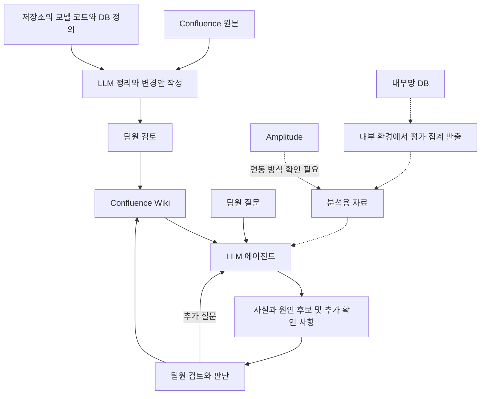

# 아키텍처와 운영 규칙

## 기본 방향

Confluence를 팀원이 기록하고 읽는 공간으로 유지합니다. 기존 원본과 LLM이 정리하는 Wiki 영역을 구분합니다. LLM 에이전트가 Wiki와 분석 도구를 사용하고, 검토한 배움을 다시 Wiki에 기록합니다.

점선은 접근 방법과 자료 구조를 확인해야 하는 연결입니다. 이 도식은 구현 상태를 나타내지 않습니다.

## Wiki 구성

| 문서 | 내용 |
| --- | --- |
| 예측 모델 처음 읽기 | 문제, 입력, 계산 흐름, 출력의 의미, 가정과 한계 |
| 도메인 용어 사전 | 정의, 예시, 유사 용어와 차이, 모델에서 쓰이는 위치 |
| DB 사전 | 테이블과 컬럼, 관계, 제약조건, 단위, 상태값, NULL의 의미 |
| 팀의 결정 | 결정 내용과 이유, 대안, 적용 범위, 근거 |
| 미정 사항 | 미해결 질문, 선택지, 결정에 필요한 정보 |
| 지표 정의 | 리텐션과 예보 품질의 계산 기준, 기간, 시간대 |
| 분석 기록 | 질문, 자료 기준 시점, 계산 방법, 사실, 가설, 한계, 후속 결정 |

문서 사이에 링크를 두어 모델 설명에서 용어, DB 구조, 결정 이유를 따라갈 수 있게 합니다.

## 원본과 변경 관리

- Confluence는 페이지 ID와 버전, 코드는 commit을 출처로 기록합니다.
- 원본과 파생 Wiki의 관계를 저장해 변경 시 영향을 받는 문서를 찾습니다.
- LLM은 원본을 수정하지 않고 Wiki 변경안을 작성합니다.
- 제안, 확정, 확인 필요를 구분합니다. 문서의 최신 날짜만으로 팀의 합의를 추정하지 않습니다.
- 기존 결정이 바뀌면 이전 이유와 새 결정의 연결을 보존합니다.
- Wiki 반영 전 현재 버전을 확인합니다. 동시 수정이 있으면 최신 문서로 변경안을 다시 작성합니다.
- 원본의 삭제와 권한 변경이 파생 문서 및 검색 결과에도 반영되어야 합니다. 여러 출처를 종합할 때도 열람 범위를 넓히지 않습니다.
- 일반 개념, 코드에서 확인한 사실, 운영 환경에서 확인한 사실을 구분합니다.

## DB 접근 제약

인바운드 규칙 때문에 외부에서 DB를 직접 조회하지 못할 것으로 예상합니다. 실제 접근 여부는 미검증입니다.

구조 설명에는 migration, DDL, Entity, 조회 코드와 설계 문서를 사용합니다. 저장소의 정의가 운영 DB에 모두 적용됐다고 단정하지 않습니다.

실제 수치는 DB에 접근 가능한 내부 환경에서 집계하여 전달하는 방식을 제안합니다. 첫 단계는 파일이며, 정기 반출이나 제한된 조회 서비스는 이후 검토합니다. DB 전체를 Wiki에 복사하지 않습니다.

## 리텐션 분석 흐름

1. 리텐션의 시작 이벤트, 재방문 이벤트, Day 7 계산 방식, 시간대와 비교 기간을 확인합니다.
2. 관찰 기간이 충분한 집단만 비교하고, 하락 여부와 규모를 계산합니다.
3. 이용 가능한 속성으로 집단별 차이를 확인합니다.
4. 같은 기간의 예보 평가와 공통 기준으로 연결합니다.
5. 배포, 모델 변경, 장애, 캠페인에 관한 기록을 대조합니다.
6. 확인된 사실, 원인 후보, 확인하지 못한 부분과 후속 조사를 설명합니다.

| 가능한 연결 기준 | 해석 가능한 범위 |
| --- | --- |
| 날짜 | 같은 시기의 지표 변화 |
| 날짜, 노선 또는 정류장, 시간대 | 특정 이용 환경의 지표 관계 |
| 공통 예보 ID와 가명 사용자 ID | 실제 예보 노출과 재방문의 관계 |

위 항목은 후보이며 실제 수집 여부는 미확인입니다. 사용자 단위 연결이 없으면 특정 사용자의 경험으로 해석하지 않습니다. 시간상 함께 변했다는 사실만으로 인과관계를 확정하지 않습니다.

LLM은 분석을 계획하고 설명하며 수치 계산은 코드로 수행합니다. 분석 기록에는 원본 버전, 집계 기준, 계산 방법을 남깁니다. 분석 결과를 원본 근거와 연결하고, 가설이 반복 인용되면서 확정 사실로 바뀌지 않도록 상태를 유지합니다.

## 참고한 공개 패턴

- [Karpathy LLM Wiki](https://gist.github.com/karpathy/442a6bf555914893e9891c11519de94f): 원본, Wiki, 운영 규칙을 분리하고 수집·질문·점검을 반복하는 패턴.
- [Glean Knowledge Graph](https://docs.glean.com/security/knowledge-graph): 기존 자료의 내용, 사람, 활동과 권한을 연결하는 구조.
- [Atlassian Rovo](https://www.atlassian.com/software/rovo/guides/end-user-guide/what-is-rovo): 연결된 업무 맥락을 검색과 답변에 활용하는 제품.
- [Guru 검증 방식](https://help.getguru.com/docs/verifying-and-unverifying-cards): 지식의 검증 상태와 담당 책임을 관리하는 방식.

공개 패턴에서 필요한 요소를 조합한 설계이며 특정 제품의 도입 결정은 아닙니다.
